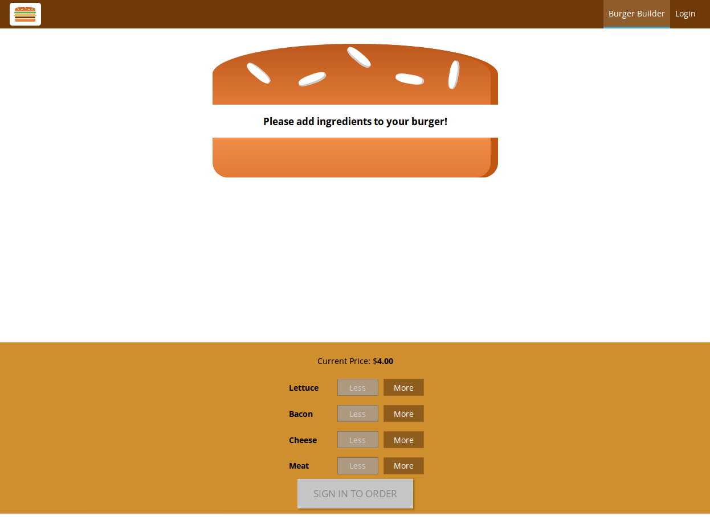
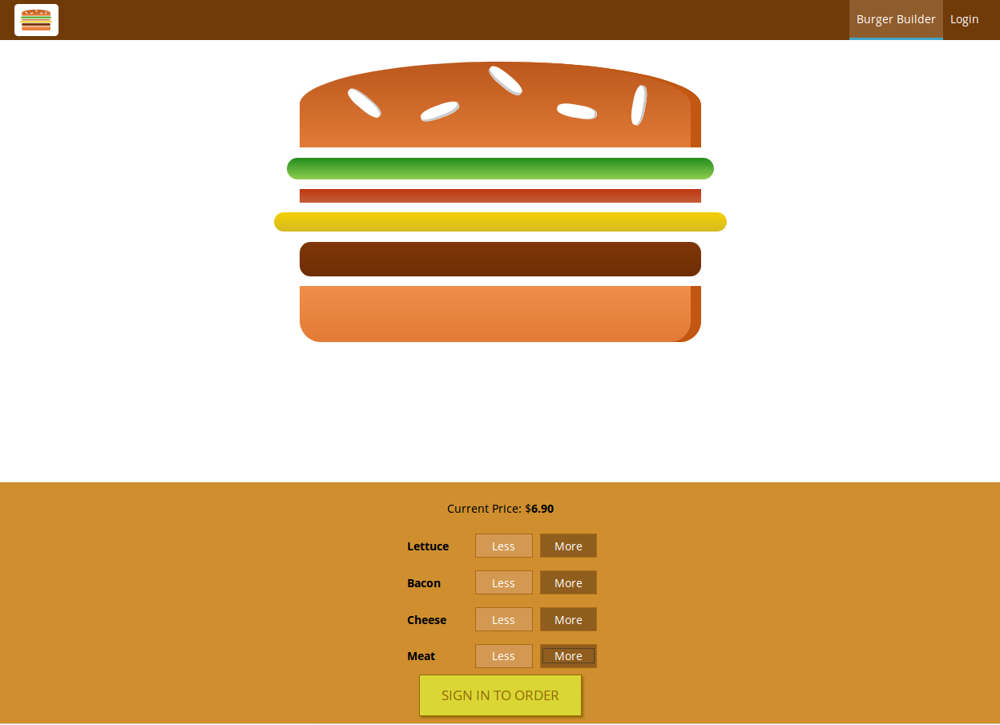
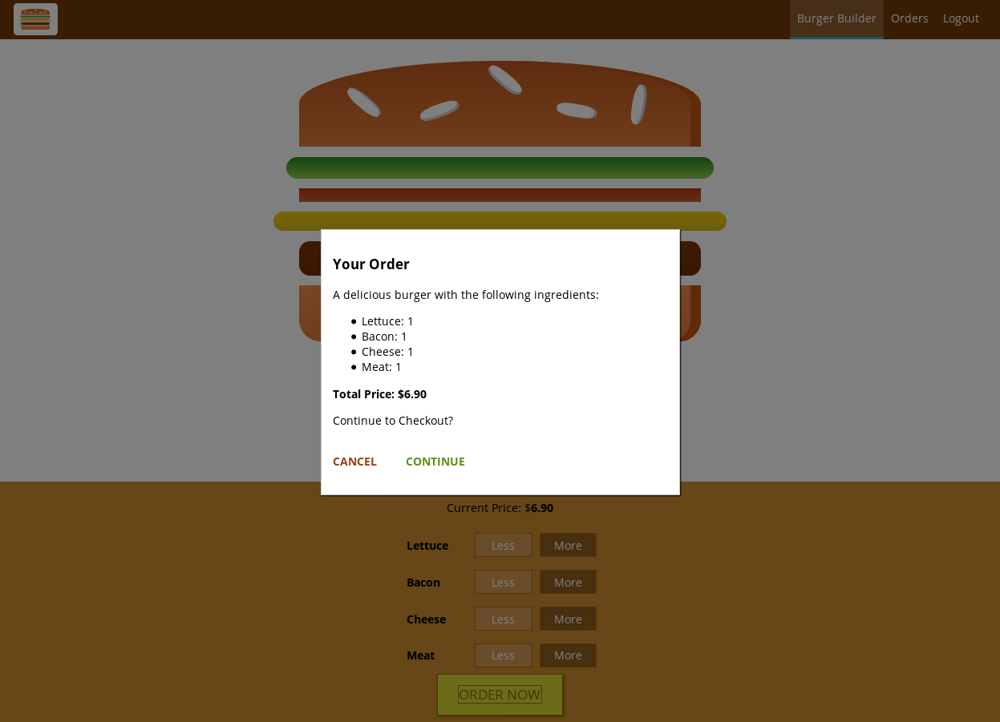
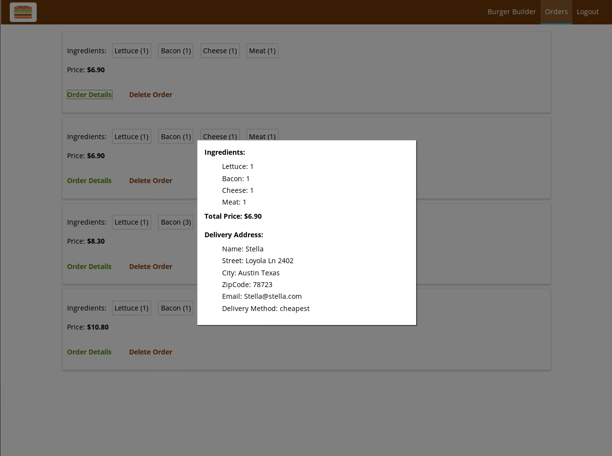
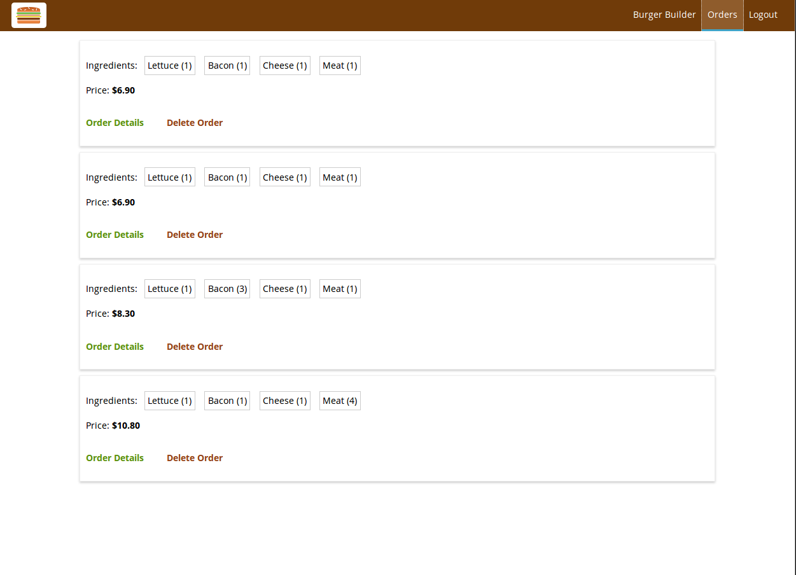

# Burger Builder

## Project Background

**Burger Builder** was my final graduation project at Austin Coding Academy.  It is a single page full stack web app built with the MERN stack where you can customize a delicious hamburger and order it online for delivery. Enjoy!

## Benefits of Project

Burger Builder helps familiarize yourself with the inner workings of React JS.  It is a fairly involved project but I believe still allows you to start from the App.js file in the client folder and trace your way through each component learning what each one does.  One of the advantages of React is the componentization of each element in the program.  It allows for less code repetition and to maintain continuity throughout the project if new features come up.  

## Objectives for this project

* Create a full stack single page web app built with the MERN stack

* Learn the React workflow and best practices

* Manage state in class based components and also with the Redux library

* Write simple RESTful APIs with NodeJS and the Express web framework to serve data to the React front end

* Use an MVC framework to organize the server side code

* Implement a mongoDB database using the Mongoose library to house orders, login credentials and customer data

## Outcome

Burger Builder is a well designed starter MERN stack project with a detached front and back end where you can begin to understand the benefits of React JS. This project also gives you the beginnings of writing simple RESTful APIs with NodeJS and shows how to organize the back end.

## Assumptions

This project assumes that you have a working knowledge of HTML, CSS, and Javascript.  Docs for each library and framework used are linked below 

## Project Links

Deployed site: _add your Render URL here_

Github repo: https://github.com/renecruzATX/burger-builder-final

React JS docs: https://react.dev/

Redux JS docs: https://redux.js.org/

NodeJS docs: https://nodejs.org/en/docs/

Express JS docs: https://expressjs.com/en/4x/api.html

mongoDB docs: https://www.mongodb.com/docs/

mongoose JS docs: https://mongoosejs.com/docs/guide.html

## Running Locally

Requires Node 20+ and a MongoDB database (a free [MongoDB Atlas](https://www.mongodb.com/atlas) cluster works).

1. Copy `server/.env.example` to `server/.env` and fill in `mongodburi` and `SECRET`
2. Install: `npm install --prefix server && npm install --prefix client`
3. Start the API (port 3004): `npm run dev:server`
4. In a second terminal, start React (port 3000): `npm run dev:client`

The React dev server proxies API calls to port 3004. All API routes live under `/api`.

## Deploying (Render free tier)

The Express server serves the built React app, so the whole thing deploys as one web service.

1. Create a free MongoDB Atlas cluster. Under Network Access, allow `0.0.0.0/0`. Copy the connection string.
2. On [Render](https://render.com): **New > Blueprint**, then pick this repo. It reads `render.yaml`.
3. When prompted, paste the Atlas connection string as `mongodburi`. `SECRET` is generated for you.
4. Put the resulting URL at the top of this README.

Free Render services sleep after about 15 minutes idle, so the first visit after that takes ~30-60 seconds to wake up.

## 2026 Update

Brought the original 2019 project back to life on current tooling:

* Node 20+, react-scripts 5, React 17, React Router 5, Mongoose 8, Express 4.21
* Replaced the deprecated `bcrypt-nodejs` with `bcryptjs` (existing password hashes still verify)
* API moved under `/api` so refreshing `/orders` or `/checkout` loads the app instead of raw JSON
* Orders are now tied to the logged-in user: users only see and delete their own orders
* Saved logins restore before the first render, so a refresh keeps you on the page you were on
* Missing ingredients document falls back to an empty burger, so a fresh database works with no seeding
* Single-service deploy config for Render, replacing the retired Heroku free tier

## Application Screenshots

Homepage

Burger with Ingredients

Order Summary

Order Details

Orders Page

